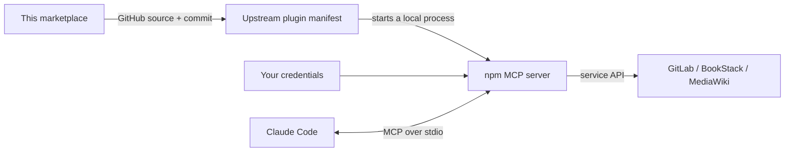

# ttpears Claude Code plugins

Connect Claude Code to **GitLab, BookStack, and MediaWiki** through one plugin marketplace. Install the services you use, supply your own credentials, and search or work with your existing repositories and documentation from Claude Code.

[Get started](docs/getting-started.md) · [Configure credentials](docs/configuration.md) · [Fix a problem](docs/troubleshooting.md) · [Maintain the catalog](CONTRIBUTING.md)

## Choose your plugin

| Plugin | What you can do | Setup guide |
| --- | --- | --- |
| **GitLab MCP** | Find projects, issues, and merge requests; inspect team activity; perform actions allowed by your token. | [GitLab](docs/plugins/gitlab.md) |
| **BookStack MCP** | Search and read documentation; enable write tools when you need to create or maintain content. | [BookStack](docs/plugins/bookstack.md) |
| **MediaWiki MCP** | Search and read one or several wikis; edit content using bot credentials. | [MediaWiki](docs/plugins/mediawiki.md) |

This repository distributes the **catalog**, not the server implementations. Each plugin comes from its upstream GitHub repository and launches an npm package on your machine. The catalog's source commits are pinned, and BookStack also pins its exact npm runtime. GitLab and MediaWiki currently use unversioned npm launch commands. See [what is versioned](docs/operations.md#understand-the-three-layers-of-versioning) before choosing an installation route.

## Quick start: BookStack

This example uses BookStack with write tools disabled. You need Claude Code, Git, Node.js 22 or newer, `npx`, and a BookStack API token. For other services or Windows setup, follow [Getting started](docs/getting-started.md).

**1. Set credentials in the terminal that will launch Claude Code.** Replace the examples with your BookStack URL and token pair.

Bash, Git Bash, or WSL:

```bash
export BOOKSTACK_BASE_URL='https://bookstack.example.com'
export BOOKSTACK_TOKEN_ID='replace-with-token-id'
export BOOKSTACK_TOKEN_SECRET='replace-with-token-secret'
export BOOKSTACK_ENABLE_WRITE='false'
```

PowerShell:

```powershell
$env:BOOKSTACK_BASE_URL = 'https://bookstack.example.com'
$env:BOOKSTACK_TOKEN_ID = 'replace-with-token-id'
$env:BOOKSTACK_TOKEN_SECRET = 'replace-with-token-secret'
$env:BOOKSTACK_ENABLE_WRITE = 'false'
```

**2. Add the marketplace and install the plugin.** These are terminal commands, shared by both shells:

```text
claude plugin marketplace add ttpears/claude-plugins
claude plugin install bookstack-mcp@ttpears --scope user
claude
```

**3. Verify the connection.** Inside Claude Code, open `/mcp`, find the BookStack server, then try:

> Search BookStack for a page I can access about onboarding and summarize the matching titles. Do not change any content.

An enabled plugin confirms installation; a successful search confirms that the service URL, credentials, and permissions work together. If the server fails, follow [Troubleshooting](docs/troubleshooting.md).

## Find the right guide

| I want to… | Read |
| --- | --- |
| Install my first plugin and choose a platform or scope | [Getting started](docs/getting-started.md) |
| Load credentials, use `.env`, or configure a desktop/IDE launch | [Configuration](docs/configuration.md) |
| Configure GitLab tokens or migrate older settings | [GitLab guide](docs/plugins/gitlab.md) |
| Configure BookStack permissions and write access | [BookStack guide](docs/plugins/bookstack.md) |
| Set up bot passwords or multiple wikis | [MediaWiki guide](docs/plugins/mediawiki.md) |
| Update, disable, remove, or pin a server package | [Operations](docs/operations.md) |
| Use direct MCP registration or a team `.mcp.json` | [Direct installation](docs/direct-install.md) |
| Diagnose a failure or report a useful issue | [Troubleshooting](docs/troubleshooting.md) |
| Update a source commit or add a plugin | [Contributing](CONTRIBUTING.md) |

## Catalog snapshot

Verified on **2026-10-31**. These are the manifests selected by the catalog. BookStack launches the exact package version shown; GitLab and MediaWiki's unversioned npm commands can resolve a different runtime version.

| Install ID | Published package | Manifest | Declared Node.js requirement |
| --- | --- | --- | --- |
| `gitlab-mcp@ttpears` | [`@ttpears/gitlab-mcp-server`](https://www.npmjs.com/package/@ttpears/gitlab-mcp-server) | `3.0.0` | 22+ |
| `bookstack-mcp@ttpears` | [`bookstack-mcp`](https://www.npmjs.com/package/bookstack-mcp) | `5.7.1` | 18+ |
| `mediawiki-mcp@ttpears` | [`mediawiki-mcp`](https://www.npmjs.com/package/mediawiki-mcp) | `2.5.4` | 20+ |

Node.js **22+** satisfies all three declared requirements. The pinned GitLab manifest additionally invokes POSIX `sh`; see its [platform note](docs/plugins/gitlab.md#runtime-and-platform).

The catalog and command examples are checked with **Claude Code 2.1.302**. This is the tested CLI version, not a minimum-version claim. The [validation workflow](.github/workflows/validate.yml) checks catalog validity. It does not install the plugins or authenticate to your services.

## How the pieces connect



The marketplace does not host a shared API endpoint or create credentials for you. HTTP, OAuth, containers, and Claude Desktop bundles are separate deployment options documented in the upstream projects.

## Project links

- [GitLab server](https://github.com/ttpears/gitlab-mcp), [BookStack server](https://github.com/ttpears/bookstack-mcp), [MediaWiki server](https://github.com/ttpears/mediawiki-mcp)
- [Report a catalog or documentation issue](https://github.com/ttpears/claude-plugins/issues)
- [Claude Code plugin documentation](https://code.claude.com/docs/en/discover-plugins)

For server behavior, API compatibility, or service authentication bugs, use the relevant upstream repository. Include the details in [Reporting a problem](docs/troubleshooting.md#reporting-a-problem).
